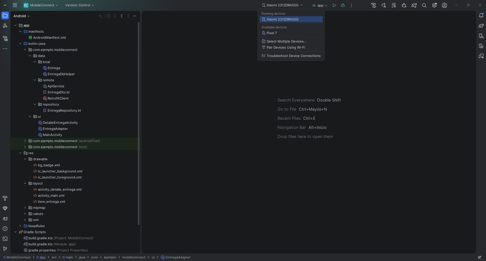
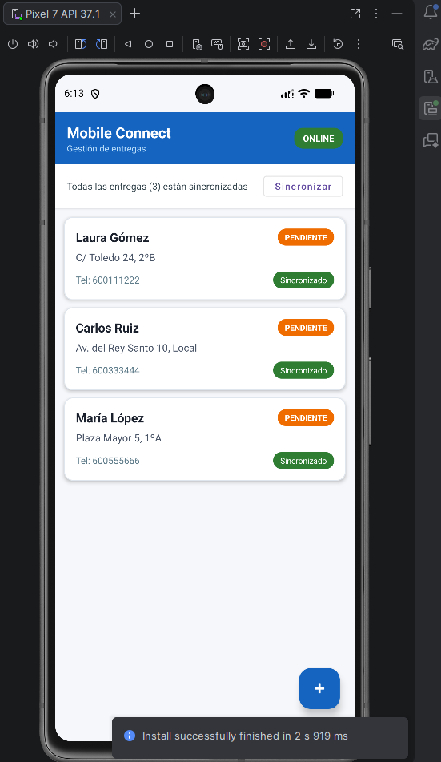
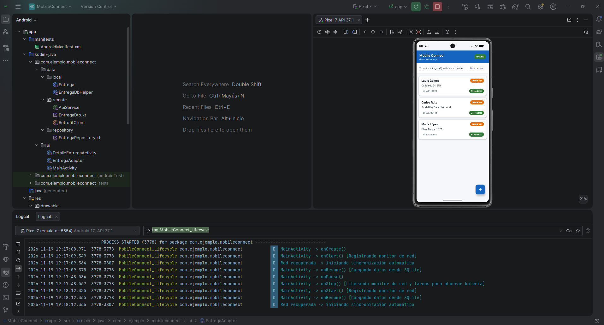
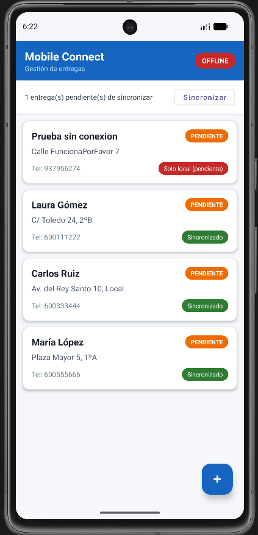
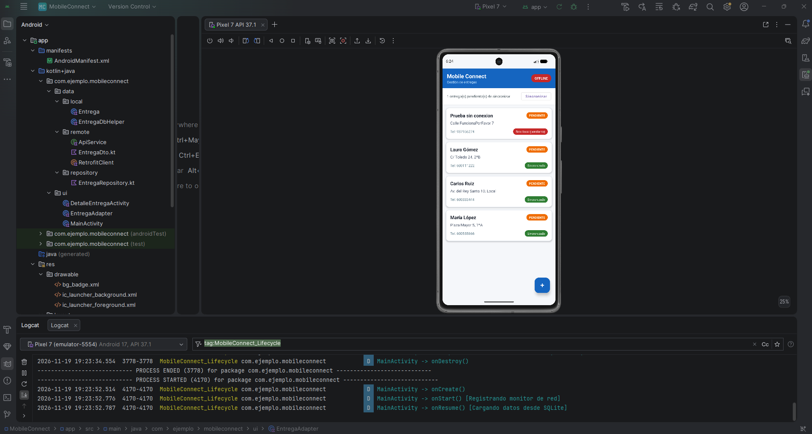
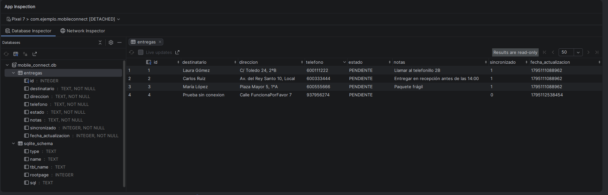
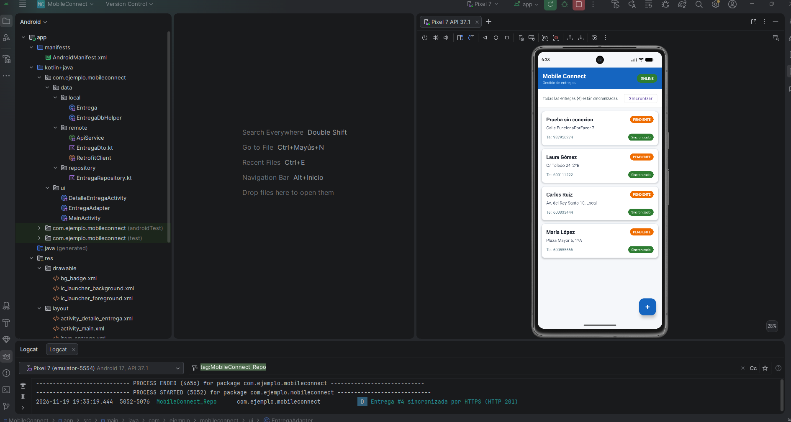
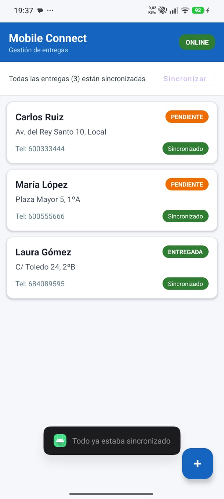

# Reto 1: Mobile Connect — Aplicación de Servicios y Persistencia

**Módulo:** Programación Multimedia y Dispositivos Móviles (2º DAM)  
**Reto:** Reto 1 de 3 — Mobile Connect (40% de los retos | RA 1 y RA 2)  
**Autor:** Diego Santos Fernández  
**Tecnologías:** Android Nativo (Kotlin), Android Studio, SQLite (`SQLiteOpenHelper`), Retrofit 2 + OkHttp (HTTPS), Kotlin Coroutines, ViewBinding y `SmsManager`.

---

## 1. Descripción general y arquitectura del proyecto

**Mobile Connect** es una aplicación móvil nativa en Android diseñada para que los repartidores de una empresa de mensajería gestionen sus entregas incluso en entornos con cobertura inestable (*Offline-First*). La aplicación permite consultar, crear, editar, eliminar y confirmar entregas, garantizando la persistencia local de los datos sin conexión, la sincronización segura por HTTPS al recuperar red y el envío de mensajes SMS de confirmación al destinatario.

El proyecto utiliza una arquitectura basada en **`Activities`** organizada por capas dentro del paquete raíz `com.ejemplo.mobileconnect`:

| Paquete | Clases principales | Responsabilidad |
| :--- | :--- | :--- |
| `data.local` | `Entrega`, `EntregaDbHelper` | Modelo de datos y gestión de la base de datos local SQLite (`mobile_connect.db`). |
| `data.remote` | `EntregaDto`, `ApiService`, `RetrofitClient` | Endpoints REST y cliente HTTPS seguro con Retrofit y OkHttp. |
| `data.repository` | `EntregaRepository`, `ResultadoSync` | Lógica *Offline-First*: persiste primero en SQLite y sincroniza por HTTPS en segundo plano. |
| `ui` | `MainActivity`, `DetalleEntregaActivity`, `EntregaAdapter` | Interfaz XML adaptada al repartidor, gestión del ciclo de vida, monitor de red y envío de SMS. |

  
*Figura 1. Estructura de paquetes por capas en Android Studio y detección del emulador AVD junto al dispositivo físico.*

---

## 2. Entorno de desarrollo y gestión del ciclo de vida (RA 1)

El proyecto está configurado en **Android Studio** con Gradle Kotlin DSL (`minSdk = 26`, `targetSdk = 36`) y **ViewBinding** para acceder a las vistas XML sin sobrecarga de `findViewById`. La aplicación se ha compilado y probado tanto en emulador (AVD) como en dispositivo físico real mediante depuración USB.

  
*Figura 2. Ejecución de Mobile Connect en el emulador AVD mostrando el listado de entregas y el indicador de estado de red.*

### Optimización de batería y memoria mediante el ciclo de vida

Para evitar fugas de memoria (*memory leaks*) y consumo innecesario de batería cuando la app pasa a segundo plano, `MainActivity` gestiona explícitamente su ciclo de vida:

* **`onCreate()`:** Infla la interfaz con `ActivityMainBinding`, inicializa `EntregaRepository`, el `RecyclerView` y `ConnectivityManager`.
* **`onStart()`:** Comprueba la conectividad actual y registra `ConnectivityManager.NetworkCallback` únicamente mientras la pantalla es visible.
* **`onResume()`:** Recarga los datos actualizados desde SQLite al volver de `DetalleEntregaActivity` o al reanudar la aplicación.
* **`onPause()` y `onStop()`:** Libera el monitor de red (`unregisterNetworkCallback`) y cancela cualquier tarea de sincronización en curso (`syncJob?.cancel()`) para ahorrar batería y memoria.
* **`onDestroy()`:** Libera los recursos asociados a la `Activity` y cancela automáticamente todas las corrutinas vinculadas a `lifecycleScope`.

Adicionalmente, `EntregaDbHelper` aplica el patrón **Singleton** apoyado en `context.applicationContext` (impidiendo retener referencias a `Activities` destruidas) y cierra todos los objetos `Cursor` de SQLite automáticamente mediante bloques `.use { ... }`.

  
*Figura 3. Trazas de Logcat (`MobileConnect_Lifecycle`) verificando `onCreate`, `onStart`, `onResume`, `onPause` y `onStop` con liberación del monitor de red.*

---

## 3. Modelo de hilos y concurrencia (no bloqueo del UI Thread)

En Android, toda la interfaz gráfica y los eventos táctiles se ejecutan en un único hilo principal (**UI Thread / Main Thread**). Ejecutar operaciones bloqueantes de red (HTTPS) o disco (SQLite) en este hilo congelaría la pantalla y provocaría errores **ANR (*Application Not Responding*)**.

Para evitarlo, en lugar del obsoleto `AsyncTask`, **Mobile Connect** implementa concurrencia estructurada mediante **Kotlin Coroutines** y **`lifecycleScope`**, separando estrictamente la ejecución en dos *Dispatchers*:

| Hilo / Dispatcher | Clases | Operaciones ejecutadas |
| :--- | :--- | :--- |
| **`Dispatchers.Main` (UI Thread)** | `MainActivity`, `DetalleEntregaActivity` | Renderizado del `RecyclerView`, actualización de indicadores (`ONLINE`/`OFFLINE`), `ProgressBar`, `Toast` y eventos de botones. |
| **`Dispatchers.IO` (Hilos secundarios)** | `EntregaRepository`, `EntregaDbHelper`, `ApiService` | Lecturas y escrituras CRUD en SQLite y peticiones de red HTTPS con Retrofit. |

### Diagrama del flujo de hilos

    +-----------------------------------------------------------------------+
    |                       HILO PRINCIPAL (UI Thread)                      |
    |                    MainActivity / DetalleEntregaActivity              |
    +-----------------------------------------------------------------------+
        |                                                               ^
        | 1. Evento de usuario (Guardar / Sincronizar)                  | 5. Actualización de UI
        |    o recuperación de red (NetworkCallback)                    |    (RecyclerView, Badges,
        |    -> lifecycleScope.launch { ... }                           |     ProgressBar, Toast)
        |    (Muestra ProgressBar sin bloquear la interfaz)             |
        v                                                               |
    +-----------------------------------------------------------------------+
    |              CAMBIO DE CONTEXTO: withContext(Dispatchers.IO)          |
    |                         (EntregaRepository)                           |
    +-----------------------------------------------------------------------+
        |                                                               ^
        | 2. Escritura local inmediata                                  | 4. Devuelve resultado
        |    en SQLite (sincronizado = 0)                               |    (Pair / ResultadoSync)
        v                                                               |
    +---------------------------+       3. Si hay red disponible        +---------------------------+
    |     SQLite Local (Disco)  | ------------------------------------> |  Servidor HTTPS (Red)     |
    |    EntregaDbHelper (.db)  | <------------------------------------ |  Retrofit + OkHttp        |
    +---------------------------+    Si HTTP 2xx -> sincronizado = 1    +---------------------------+
                                     Si fallo/sin red -> queda en cola

### Garantías del modelo de concurrencia

1. **Fluidez total de la interfaz:** Todas las operaciones bloqueantes de disco y red se ejecutan en el *pool* de hilos de E/S (`Dispatchers.IO`), manteniendo libre el hilo principal en todo momento.
2. **Cancelación automática segura:** Al estar ligadas a `lifecycleScope`, las corrutinas se cancelan automáticamente si el usuario cierra la `Activity` antes de finalizar una petición HTTPS, evitando fugas de memoria.
3. **Tolerancia a fallos de red:** Las peticiones HTTPS cuentan con *timeouts* de 10 segundos en `OkHttpClient` y manejo de excepciones (`try/catch`), garantizando que una pérdida súbita de cobertura nunca provoque un cierre inesperado (*crash*).

---

## 4. Persistencia local en SQLite y estrategia Offline-First (RA 2)

Para asegurar que el repartidor nunca pierda información al entrar en zonas sin cobertura, la aplicación almacena las entregas en la base de datos local **SQLite** (`mobile_connect.db`, tabla `entregas`) con los campos `id`, `destinatario`, `direccion`, `telefono`, `estado` (`PENDIENTE` / `ENTREGADA`), `notas`, `sincronizado` (`0` o `1`) y `fecha_actualizacion`.

Toda creación o modificación se persiste **primero en SQLite** marcada con `sincronizado = 0`. Si el dispositivo está en modo sin conexión, el registro queda visible con la etiqueta roja **"Solo local (pendiente)"** y sobrevive al cierre completo del proceso desde la multitarea.

  
*Figura 4. Creación de una entrega en Modo Avión (`OFFLINE`), quedando guardada en local como pendiente de sincronizar.*

  
*Figura 5. Verificación de persistencia tras cerrar completamente la aplicación desde la multitarea sin cobertura y volver a abrirla.*

  
*Figura 6. Verificación en tiempo real de la tabla `entregas` en `mobile_connect.db` mediante Database Inspector (`sincronizado = 0`).*

---

## 5. Conectividad HTTPS y mensajería SMS (RA 2)

### Sincronización segura por HTTPS

La comunicación con el servidor remoto (`https://jsonplaceholder.typicode.com/`) se implementa con **Retrofit 2 + Gson** exclusivamente sobre **HTTPS**, reforzado en `AndroidManifest.xml` mediante `android:usesCleartextTraffic="false"` para bloquear tráfico sin cifrar.

Al desactivar el Modo Avión o recuperar cobertura, el `NetworkCallback` actualiza el estado visual a **`ONLINE`** y dispara `repository.sincronizarPendientes()` en `Dispatchers.IO`, enviando por `POST` las entregas pendientes y actualizando `sincronizado = 1` al recibir confirmación `HTTP 201`.

  
*Figura 7. Trazas de Logcat (`MobileConnect_Repo`) confirmando la sincronización HTTPS automática (`HTTP 201`) al recuperar conexión.*

### Confirmación de entregas por SMS

Desde `DetalleEntregaActivity`, el repartidor puede confirmar una entrega y notificar al cliente por mensaje de texto:

* **Gestión de permisos en tiempo de ejecución:** Se verifica y solicita `Manifest.permission.SEND_SMS` mediante `ActivityResultContracts.RequestPermission()`.
* **Envío directo y respaldo seguro:** Si el usuario concede el permiso, el envío se realiza mediante `SmsManager` (compatible con Android 12+ y soporte multiparte para mensajes largos). Si el permiso es denegado o el dispositivo no dispone de módulo telefónico/SIM, se ejecuta un *fallback* mediante `Intent(Intent.ACTION_SENDTO)` (`smsto:`) abriendo la app de mensajes con el texto pre-rellenado.

---

## 6. Validación final en dispositivo físico real

Se han validado todas las funcionalidades requeridas (ciclo de vida, modo sin cobertura, persistencia en SQLite tras cierre completo, sincronización HTTPS en hilos secundarios y envío de SMS) en un dispositivo Android físico real conectado por depuración USB, verificando la actualización final a **`ENTREGADA`** y **`Sincronizado`**.

  
*Figura 9. Mobile Connect ejecutándose en dispositivo físico real con la entrega confirmada (`ENTREGADA`) y sincronizada correctamente.*

---

## 7. Cómo ejecutar el proyecto

1. Abrir la carpeta raíz del proyecto en **Android Studio**.
2. Esperar a que finalice la sincronización de Gradle.
3. Seleccionar un emulador (AVD) con API 26+ o un dispositivo físico con depuración USB activada.
4. Pulsar **Run (`▶`)** para compilar e instalar la aplicación.
